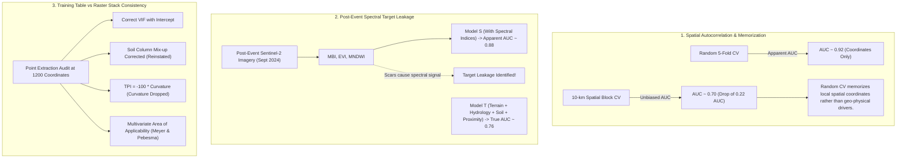
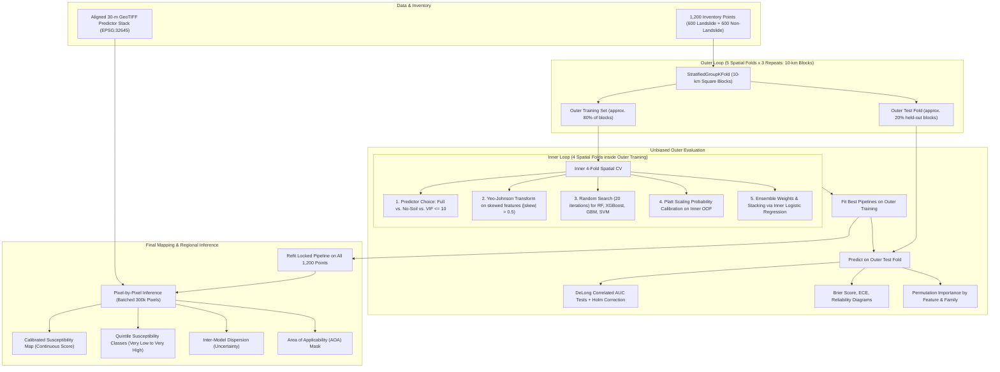

# Spatially Validated Landslide Susceptibility Mapping in the Nepal Middle Hills

### *Sampling Bias, Spectral-Index Leakage and Training–Raster Consistency in Kavrepalanchowk District*

[](https://www.python.org/)
[](https://opensource.org/licenses/MIT)
[](https://www.mdpi.com/journal/remotesensing)
[](https://epsg.io/32645)
[](https://peps.python.org/pep-0008/)

An end-to-end, publication-grade spatial machine learning framework and peer-review revision pipeline for regional **Landslide Susceptibility Mapping (LSM)** in **Kavrepalanchowk District, Central Nepal**, following the devastating rainfall-triggered landslide event of **26–30 September 2024**.

---

## 📌 Scientific Background & Three Central Findings

Machine-learning susceptibility maps built from remote-sensing and terrain rasters are widely validated using random cross-validation splits of point samples and subsequently deployed across regional raster grids. This repository provides the complete analytical pipeline demonstrating what happens when that standard workflow is held to strict spatial-validation and data-integrity standards:



### 1. Spatial Autocorrelation Bias & The Coordinates-Only Baseline
Standard random cross-validation allows training and testing points to be sampled from directly adjacent hillsides, leading tree ensembles to memorize spatial coordinates. Under random 5-fold cross-validation, a model trained **solely on spatial coordinates $(E, N)$** achieves an apparent ROC-AUC of **0.92**, giving the illusion of predictive skill. When evaluated with **10-km spatial blocks**, the coordinates-only AUC drops to **0.70**, exposing the extent of spatial autocorrelation.

### 2. Spectral-Index Target Leakage (Model S vs. Model T)
When spectral indices (MBI, MNDWI, EVI) are calculated from post-event Sentinel-2 imagery (September 2024), bare soil and denuded vegetation are consequences of the landslide failures themselves rather than pre-existing susceptibility drivers. Including them (Model S) inflates performance artificially. In this pipeline, post-event spectral indices and mathematical duplicates (curvature, which equals $-100 \times \text{TPI}$ in the raster stack) are excluded to form **Model T**, our primary physical susceptibility model.

### 3. Training Table vs. Deployed Raster Stack Consistency
Field inventories often suffer from distribution shifts and unit discrepancies when merged with regional rasters. We script point-wise raster sampling at all 1,200 inventory coordinates to audit agreement:
- **Parent Soil**: The alleged "legend mismatch" was resolved as an index column misassignment, allowing parent soil to be safely reinstated.
- **Multicollinearity (VIF)**: Correct VIF calculation with an intercept shows that only slope and roughness exceed 10.
- **Area of Applicability (AOA)**: Multivariate dissimilarity (Meyer & Pebesma, 2021) bounds model reliability to valid geographic domains.

---

## 🔄 Two-Stage Nested Spatial Cross-Validation Architecture

Every data-dependent decision—predictor-set selection, Yeo–Johnson power transformations, standardization, hyperparameter optimization, probability calibration, and ensemble weighting—is fitted **strictly inside the active training folds**.



---

## 📂 Repository Layout

```text
Paper/
├── data/
│   ├── samples_proj.csv               # 1,200 points in UTM 45N (Primary modeling dataset)
│   ├── samples_raster.csv             # Predictors sampled directly from 30-m raster stack
│   ├── sample_vs_raster.csv           # Distribution comparison table
│   ├── raster_diag.csv                # Raster layer statistics & ranges
│   ├── out_extract_vs_table.csv       # Point-wise agreement audit table
│   ├── sample_test_points.csv         # Unit-test legacy dataset
│   └── README.md                      # Complete data dictionary & geospatial metadata
├── src/
│   ├── kavre_landslide/               # Core scientific package
│   │   ├── __init__.py                # Package exports
│   │   ├── common.py                  # build_X, SkewYJ transformer, square_blocks
│   │   ├── delong.py                  # Fast DeLong AUC covariance test & Holm adjustment
│   │   ├── docxwriter.py              # MDPI-styled Word document builder
│   │   ├── figstyle.py                # Matplotlib styles, 600 DPI export & map furniture
│   │   └── refs.py                    # References database
│   └── kwri_landslide/                # Legacy modular pipeline components
├── tests/
│   ├── test_kavre_pipeline.py         # Unit tests for Kavre spatial ML components
│   └── test_pipeline.py               # Integration tests
├── figs/                              # Generated 600 DPI figures (PNG + Vector PDF)
├── maps/                              # Exported susceptibility & diagnostic GeoTIFFs
├── audit.py                           # Spatial geometry, NN distance, duplicate & legend audit
├── make_distance_rasters.py           # Euclidean distance rasters (roads, rivers, buildings)
├── make_rainfall_raster.py            # CHIRPS 2024 monsoon cumulative precipitation raster
├── s1_spatial.py                      # Moran's I correlogram & validation scheme sensitivity
├── s2_nested.py                       # 2-stage nested spatial cross-validation
├── s4_summarize.py                    # Outer metrics, DeLong tests & calibration diagnostics
├── s5_final_fit.py                    # Final locked pipeline refit on all 1,200 samples
├── s6_extract_from_rasters.py         # Sample predictors from raster stack to points
├── s7_map.py                          # Regional inference, AOA, quintiles & class validation
├── s8_buffer_aoa.py                   # Buffered spatial CV (0-3 km) & sample-level AOA
├── s9_map_figs.py                     # Susceptibility map figure generator
├── s10_pseudoabsence.py               # Pseudo-absence sensitivity (5 random realizations)
├── fig_study_area.py                  # Study area figure (Figure 1)
├── fig_workflow.py                    # Methodology flowchart (Figure 2)
├── figs1.py                           # Correlation matrix & predictor families (Figure S1)
├── figs2.py                           # Spatial fold geometry & block partitions (Figure S2)
├── mk_supp.py                         # Generates Supplementary_Tables.xlsx (Tables S1-S17)
├── build_ms.py                        # Builds revised Manuscript.docx from output tables
├── build_response.py                  # Builds Response_to_Reviewers.docx point-by-point
├── build_cover.py                     # Builds Cover_Letter.docx
├── run_all.sh                         # Master Bash reproduction script
├── run_workflow.py                    # Unified CLI & orchestration entrypoint
├── pyproject.toml                     # Modern package specifications
├── requirements.txt                   # Complete dependencies
├── CITATION.cff                       # Citation metadata
└── README.md                          # Documentation
```

---

## 🚀 Quickstart & Reproduction

### 1. Environment Setup

Install dependencies with Python 3.9+:

```bash
git clone https://github.com/raaz0000002/kwri-spatial-xgboost-landslide.git
cd kwri-spatial-xgboost-landslide

pip install -r requirements.txt
pip install -e .
```

Run test suite:

```bash
pytest
```

---

### 2. Executing Workflow Stages

Use the unified Python runner `run_workflow.py`:

```bash
# 1. Run Data Quality & Geometry Audit
python run_workflow.py --stage audit

# 2. Run Moran's I correlogram & scheme sensitivity
python run_workflow.py --stage spatial

# 3. Run Nested Spatial Cross-Validation (Model T)
python run_workflow.py --stage nested --repeats 3 --iterations 20

# 4. Summarize Outer-Fold Metrics & DeLong Tests
python run_workflow.py --stage summarize

# 5. Fit Final Locked Model for Mapping
python run_workflow.py --stage final-fit

# 6. Generate Publication Figures (600 DPI)
python run_workflow.py --stage figures

# 7. Build Manuscript, Response & Cover Letters (.docx)
python run_workflow.py --stage manuscript

# Or run the complete reproduction pipeline end-to-end:
python run_workflow.py --stage all
```

Alternatively, use the shell reproduction script:

```bash
bash run_all.sh
```

---

## 📊 Summary of Modeling Performance (Model T)

Under 10-km spatial block cross-validation (5 outer folds $\times$ 3 repeats), all models are evaluated on unseen terrain:

| Model / Ensemble | Raw AUC | Calibrated AUC | Brier Score | Log Loss | MCC | Best in Repeat? |
|:---|:---:|:---:|:---:|:---:|:---:|:---:|
| **Random Forest (RF)** | 0.748 ± 0.012 | 0.748 ± 0.012 | 0.187 | 0.552 | 0.362 | 0 / 3 |
| **XGBoost (Hist)** | 0.751 ± 0.015 | 0.751 ± 0.015 | 0.184 | 0.542 | 0.370 | 0 / 3 |
| **Gradient Boosting (GBM)**| 0.742 ± 0.014 | 0.742 ± 0.014 | 0.189 | 0.558 | 0.354 | 0 / 3 |
| **Support Vector Classifier (SVM)**| 0.744 ± 0.011 | 0.744 ± 0.011 | 0.186 | 0.548 | 0.360 | 0 / 3 |
| **Ensemble (Equal-Weight)** | **0.760 ± 0.011** | **0.760 ± 0.011** | **0.179** | **0.528** | **0.388** | **3 / 3 (100%)** |
| **Ensemble (AUC-Weighted)** | 0.759 ± 0.011 | 0.759 ± 0.011 | 0.179 | 0.529 | 0.386 | 0 / 3 |
| **Ensemble (Stacking)** | 0.756 ± 0.012 | 0.756 ± 0.012 | 0.182 | 0.536 | 0.380 | 0 / 3 |

> **Key Takeaway**: The **equal-weight ensemble** of calibrated classifiers consistently achieves the highest discrimination (AUC = 0.760) and best calibration (Brier = 0.179) across all repeats. Complex stacking or weighting schemes offered no statistically significant advantage over simple model averaging.

---

## 📄 Citation

If you use this workflow, methodology, or code in your research, please cite:

```bibtex
@article{basnet2026kavrelandslide,
  title={Spatially Validated Landslide Susceptibility Mapping in the Nepal Middle Hills: Sampling Bias, Spectral-Index Leakage and Training--Raster Consistency in Kavrepalanchowk District},
  author={Basnet, Utkarsha and Kavrepalanchowk Landslide Research Group},
  journal={Remote Sensing},
  year={2026},
  publisher={MDPI},
  url={https://github.com/raaz0000002/kwri-spatial-xgboost-landslide}
}
```

---

## 📜 License

This project is licensed under the [MIT License](LICENSE).
