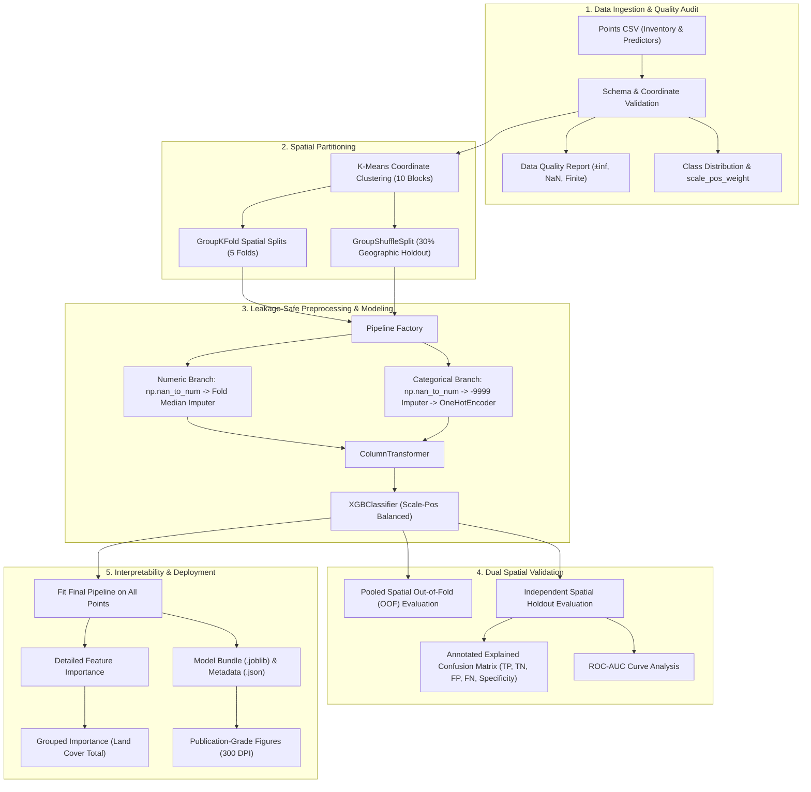

# KWRI Spatial XGBoost: Leakage-Safe Landslide Susceptibility Mapping

[](https://www.python.org/)
[](https://opensource.org/licenses/MIT)
[](.github/workflows/python-tests.yml)
[](https://peps.python.org/pep-0008/)

An end-to-end, publication-grade spatial machine learning framework for regional **Landslide Susceptibility Mapping (LSM)** using **XGBoost**. Developed for the Kentucky Water Resources Research Institute (KWRI) study area, this repository provides a strictly **leakage-safe**, **spatially blocked**, and **scalable** pipeline designed to eliminate spatial autocorrelation bias in geohazard modeling.

---

## 📌 Scientific Background & Motivation

In conventional machine learning applied to spatial geohazards, standard random cross-validation (Random $k$-Fold) causes **severe optimistic performance bias** (spatial data leakage). Because neighboring landslide points share similar geological, topographic, and meteorological properties, random splitting trains on points directly adjacent to testing points. This leads models to memorize local spatial coordinates rather than learning true geological mechanisms.

### Our Solution
1. **Spatial Blocking via K-Means**: Coordinates ($\text{POINT\_X}, \text{POINT\_Y}$) partition observations into contiguous geographic blocks.
2. **GroupKFold Cross-Validation**: Folds are partitioned by entire spatial clusters, ensuring the model is evaluated solely on unseen geographic terrain.
3. **GroupShuffleSplit Holdout**: An isolated 30% of geographic blocks are withheld completely for independent spatial generalization testing.
4. **Encapsulated Preprocessing**: Missing value imputation and one-hot encodings are computed strictly inside active training folds within `sklearn.pipeline.Pipeline(ColumnTransformer)`.

---

## 🔄 End-to-End Workflow Architecture



---

## 📂 Repository Structure

```text
Paper/
├── .github/
│   └── workflows/
│       └── python-tests.yml           # CI/CD Automated Test Pipeline
├── data/
│   ├── sample_test_points.csv         # 120-row demo dataset with Kentucky coordinates
│   └── README.md                      # Data dictionary, schema & NLCD classifications
├── docs/
│   └── references/                    # Original workflow documents
├── notebooks/
│   └── KWRI_XGBoost_Landslide_Susceptibility_Workflow.ipynb  # Step-by-step interactive notebook
├── src/
│   └── kwri_landslide/                # Core modular package
│       ├── __init__.py                # Package exports
│       ├── config.py                  # WorkflowConfig dataclass & hyperparameters
│       ├── data.py                    # Data loader, validator & quality audit
│       ├── spatial.py                 # Spatial K-Means blocking & holdout partitioner
│       ├── pipeline.py                # Preprocessing & XGBoost pipeline factory
│       ├── evaluation.py              # Spatial CV, OOF metrics & holdout evaluation
│       ├── visualization.py           # 300 DPI publication figure generator
│       ├── explainability.py          # NLCD decoding & grouped feature importance
│       └── export.py                  # Model bundle serialization & metadata inventory
├── tests/
│   ├── __init__.py
│   └── test_pipeline.py               # Automated unit & integration tests
├── .gitignore                         # Git exclusion rules
├── CITATION.cff                       # Citation metadata for academic publications
├── LICENSE                            # MIT License
├── pyproject.toml                     # Modern package build configuration
├── requirements.txt                   # Pinned dependency requirements
├── README.md                          # Repository documentation
└── run_workflow.py                    # Unified entrypoint (Interactive GUI + Headless CLI)
```

---

## 🚀 Quickstart Guide

### 1. Installation

Clone the repository and install dependencies in a virtual environment:

```bash
# Clone the repository
git clone https://github.com/username/kwri-landslide-susceptibility.git
cd kwri-landslide-susceptibility

# Create and activate virtual environment
python -m venv venv
source venv/bin/activate        # On Linux/macOS
venv\Scripts\activate           # On Windows

# Install dependencies and editable package
pip install -r requirements.txt
pip install -e .
```

---

### 2. Execution Modes

This repository provides **three flexible ways** to run the workflow:

#### Mode A: Interactive Runner (GUI File Picker & Terminal Prompts)
Run the script without arguments. It will detect existing CSV files or launch a native OS file picker window:
```bash
python run_workflow.py
```

#### Mode B: Automated Headless CLI (Scalable / Batch / Cloud)
Run completely unattended for automated pipelines, remote servers, or cluster environments:
```bash
python run_workflow.py --input data/sample_test_points.csv --output outputs/my_experiment --headless
```

**CLI Command Options**:
| Option | Short | Default | Description |
|---|:---:|:---:|---|
| `--input` | `-i` | `None` | Path to points CSV dataset. |
| `--output` | `-o` | `outputs/XGBoost_KWRI_Spatial_Final` | Destination directory for all results. |
| `--clusters` | | `10` | Number of spatial K-Means geographic blocks. |
| `--folds` | | `5` | Number of spatial cross-validation folds. |
| `--holdout-frac` | | `0.30` | Fraction of spatial blocks reserved for holdout. |
| `--threshold` | | `0.50` | Probability cutoff threshold for landslide classification. |
| `--seed` | | `42` | Random seed for deterministic reproducibility. |
| `--headless` | | `False` | Run non-interactively without GUI dialogs or prompts. |

#### Mode C: Interactive Jupyter Notebook
Open the step-by-step notebook in JupyterLab or VS Code to visualize intermediate tables and inspect results cell-by-cell:
```bash
jupyter notebook notebooks/KWRI_XGBoost_Landslide_Susceptibility_Workflow.ipynb
```

---

## 📊 Expected Outputs Catalog

When the workflow completes, the output folder contains complete artifacts:

### 1. High-Resolution Publication Visualizations (300 DPI)
- `xgboost_class_distribution.png`: Non-landslide vs. landslide balance bar chart.
- `xgboost_spatial_cross_validation.png`: 5-fold cross-validation performance with fold standard-deviation error bars.
- `xgboost_spatial_holdout_confusion_matrix_explained.png`: Annotated 10×7 confusion heatmap with callout box displaying TP, TN, FP, FN, Precision, Recall, Specificity, and F1-Score.
- `xgboost_spatial_holdout_roc_curve.png`: Receiver Operating Characteristic (ROC) curve showing spatial holdout AUC.
- `xgboost_final_feature_importance_detailed.png`: Individual predictor importance ranking on a shared scale.
- `xgboost_final_feature_importance_grouped.png`: Predictor importance with all NLCD categories unified into *"Land Cover Total"*.

### 2. Tabular Results & Evaluation Tables (CSV)
- `xgboost_predictor_data_quality.csv`: Audit of missing, $\pm\infty$, and finite counts per feature.
- `xgboost_spatial_cross_validation_metrics.csv`: Fold-by-fold and aggregated mean/std scores.
- `xgboost_spatial_oof_metrics.csv`: Unbiased pooled out-of-fold metrics across all points.
- `xgboost_spatial_oof_predictions.csv`: Point-level out-of-fold predicted probabilities.
- `xgboost_spatial_holdout_metrics.csv`: Independent spatial holdout summary metrics.
- `xgboost_spatial_holdout_explained_metrics.csv`: Comprehensive contingency breakdown (TN, FP, FN, TP, Specificity).
- `xgboost_spatial_holdout_predictions.csv`: Predictions on withheld spatial holdout points.
- `xgboost_spatial_holdout_classification_report.csv`: Class-specific precision, recall, and F1 scores.
- `xgboost_final_feature_importance_detailed.csv`: Detailed feature split contributions.
- `xgboost_final_feature_importance_grouped.csv`: Grouped feature contributions.
- `xgboost_all_point_predictions_IN_SAMPLE.csv`: Model fitted predictions across all records (`IN_SAMPLE_NOT_VALIDATION`).
- `xgboost_spatial_results_inventory.csv`: Complete byte-size inventory of all generated files.

### 3. Trained Model Artifacts & Metadata
- `xgboost_kwri_spatial_final_pipeline.joblib`: Complete trained scikit-learn Pipeline ready for susceptibility map inference on regional GIS rasters.
- `xgboost_kwri_spatial_holdout_pipeline.joblib`: Model fitted on spatial training split only.
- `xgboost_kwri_spatial_model_bundle.joblib`: Self-contained bundle containing pipeline, feature names, thresholds, and configuration.
- `xgboost_spatial_run_settings.json`: Reproducibility metadata documenting parameters, record counts, and paths.

---

## 🧪 Automated Testing

Execute the test suite verifying configuration, schema validation, spatial grouping, and pipeline execution:

```bash
# Run tests with unittest
python -m unittest discover tests -v

# Or run with pytest
pytest tests/ -v
```

---

## 📜 Citation

If you use this spatial machine learning workflow, code, or methodology in your academic paper or research project, please cite:

```bibtex
@software{basnet2026kwri,
  author       = {Basnet, Utkarsha and KWRI Research Group},
  title        = {KWRI Spatial XGBoost Landslide Susceptibility Workflow},
  year         = {2026},
  version      = {1.0.0},
  publisher    = {GitHub},
  url          = {https://github.com/username/kwri-landslide-susceptibility}
}
```

---

## 📄 License

This project is licensed under the terms of the [MIT License](LICENSE).
